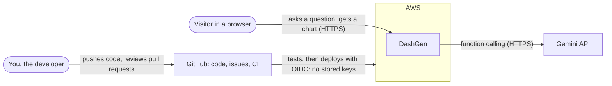
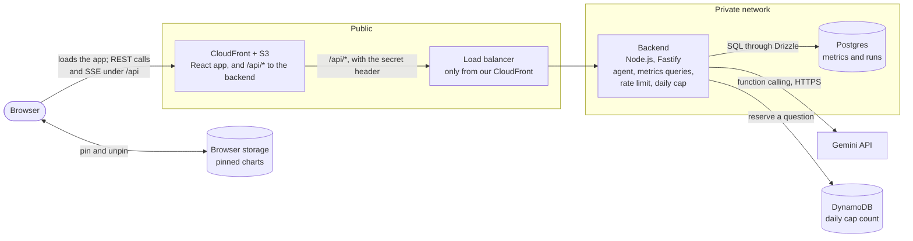
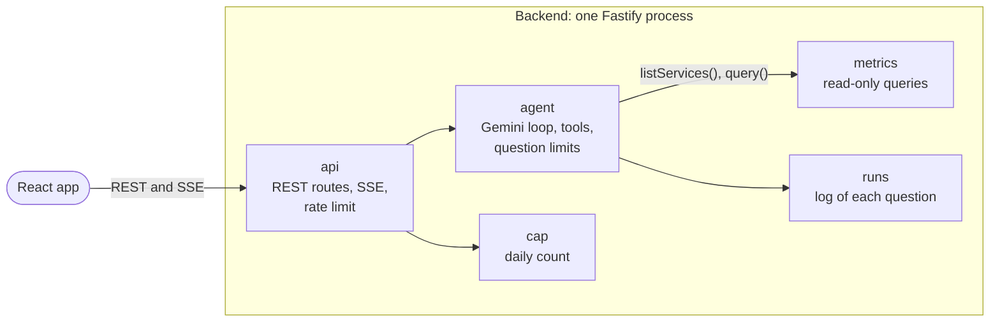
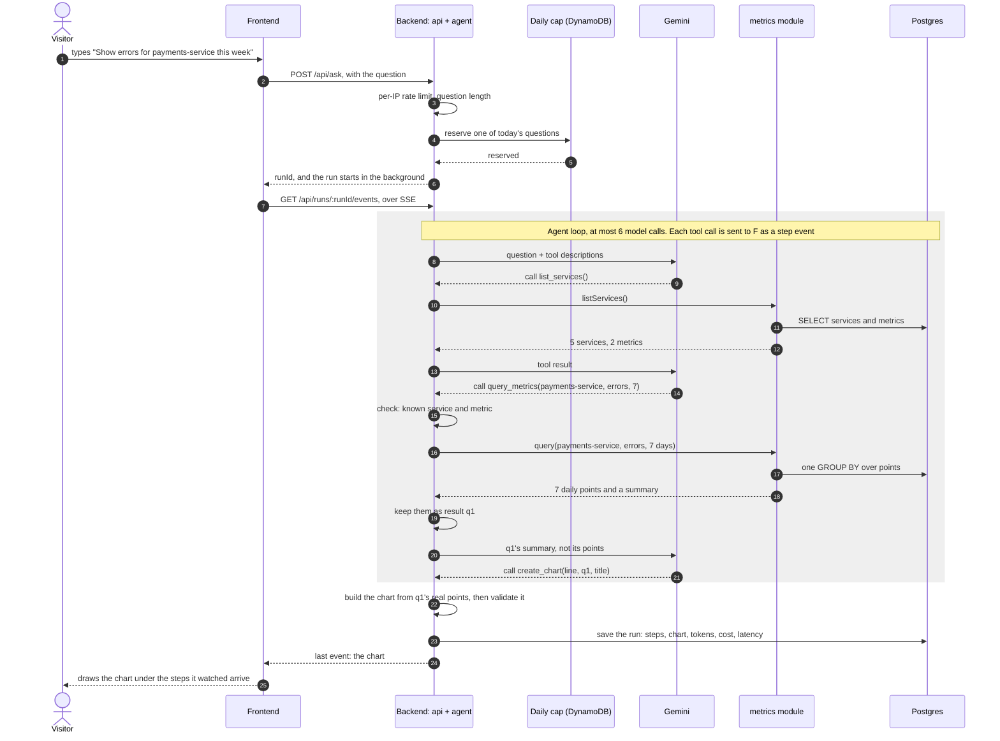
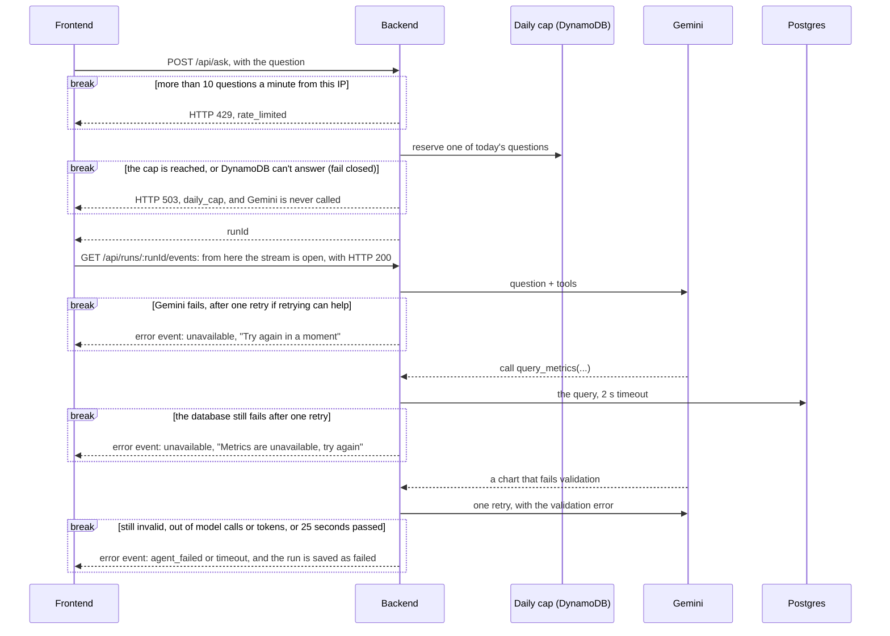
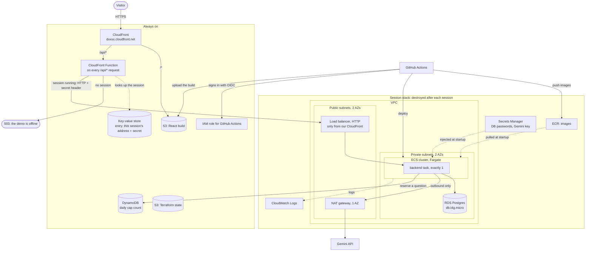
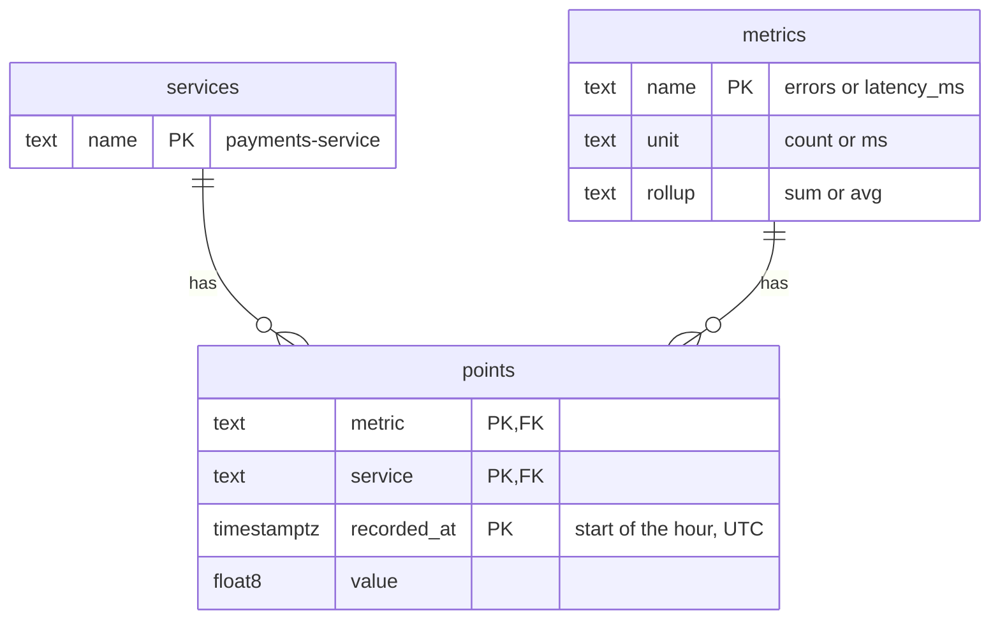
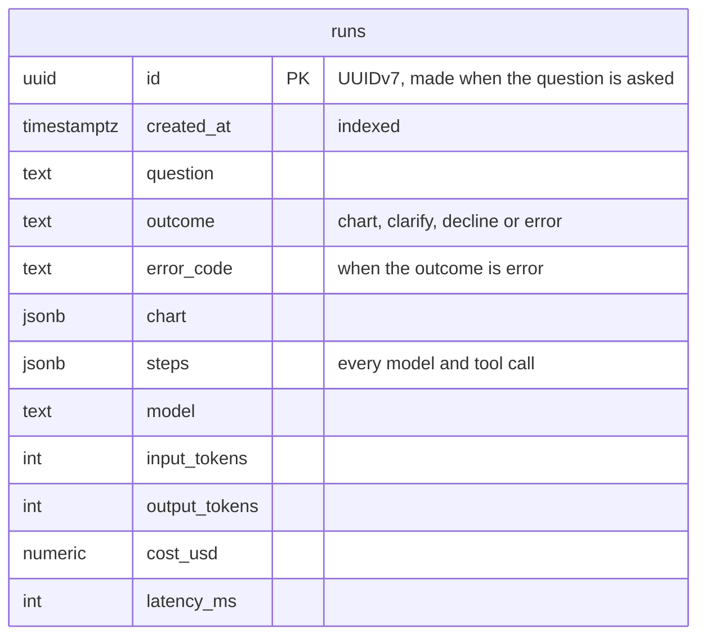

# System design

How DashGen should be built, and why. [architecture.md](architecture.md) describes what exists today; this doc works out the target, one step at a time: requirements, then estimates, then the design, deep dives and decisions. Sections are added as each step is worked through.

## 1. Requirements

### What it does

- Turns a plain-English question about the sample metrics into one chart (line, bar or pie), with the steps the agent took.
- Asks a clarifying question, with clickable choices, when the question is vague, and refuses off-topic questions with a few examples.
- Lets visitors pin charts to a dashboard saved in their browser. There are no accounts.
- Later, each as its own step: CSV upload, after the frontend works, and an MCP server.

### How well

| | Requirement |
|---|---|
| Users | Demo visitors: tens to a few hundred questions a day, with short spikes when the project is shared |
| Uptime | Up only while it's being worked on or demoed. A demo video covers the rest; there's no uptime promise |
| Budget | Under $25 a month for AWS and Gemini together |
| Speed | A chart within about 10 seconds |
| Data | Sample data only. Visitors can't change it |
| Security | Public and anonymous. The main risks are cost abuse and prompt injection. No personal data is stored |

### Out of scope for now

- Accounts and sign-in
- Real customer data
- High availability and multiple regions

## 2. Estimates

### Traffic

- 300 questions on a busy day average 0.0035 a second. A spike of 50 visitors asking 3 questions each within 10 minutes is 0.25 a second.
- Each question holds a request open for about 10 seconds, mostly waiting on Gemini, so even a spike means only 2–3 requests in flight at once.

### Gemini, per question

- 3–4 model calls: listing services, one or two queries, and creating the chart, which ends the run.
- About 8,000 input and 1,500 output tokens in total, because each call resends the conversation so far, including the tool descriptions and results. Thinking tokens are billed as output, so a model that thinks costs more.

| Model | Per 1M tokens, input / output | Per question | 300 questions |
|---|---|---|---|
| `gemini-3.1-flash-lite` | $0.25 / $1.50 | ~$0.004 | ~$1.30 |
| `gemini-3.8-flash`, until Dec 31, 2026 | $0.75 / $3.75 | ~$0.012 | ~$3.50 |
| `gemini-3.8-flash`, from Jan 1, 2027 | $1.50 / $7.50 | ~$0.023 | ~$7.00 |

Prices are from [Google's pricing page](https://ai.google.dev/gemini-api/docs/pricing), checked on 2026-10-26. Both models also have a rate-limited free tier, which is enough for development.

### Other providers, per question

| Model | Per 1M tokens, input / output | Per question | 300 questions |
|---|---|---|---|
| Claude Haiku 5.5, prompts up to 100K tokens | $0.10 / $0.50 | ~$0.0016 | ~$0.50 |
| OpenAI `gpt-6-luna` | $0.10 / $0.50 | ~$0.0016 | ~$0.50 |
| Claude Sonnet 5.5 | $2 / $10 | ~$0.031 | ~$9.30 |
| OpenAI `gpt-6-sol` | $2 / $10 | ~$0.031 | ~$9.30 |

Prices are from [Anthropic's](https://platform.claude.com/docs/en/about-claude/pricing) and [OpenAI's](https://developers.openai.com/api/docs/pricing) pricing pages, checked on 2026-10-26. At list prices, the smallest Claude and OpenAI models cost about a third of Gemini 3.1 Flash-Lite. Every small model fits the budget, though, so the choice comes down to how reliably each one calls tools, which step 6's evals measure, plus Gemini's free tier during development. The backend keeps the model behind one small interface, so switching providers stays a contained change.

### AWS, while the stack is up

Approximate on-demand prices in us-east-1. Check them in the AWS pricing calculator before step 5.

| Part | Per hour |
|---|---|
| NAT gateway | $0.045 |
| Load balancer | $0.0225, plus a little per use |
| Postgres (db.t4g.micro) | $0.016 |
| One Fargate task (0.25 vCPU, 0.5 GB) | $0.0125 |
| Three public IPv4 addresses | $0.015 |
| **Total** | **about $0.11** |

- A 4-hour session costs about $0.45, so ten sessions a month cost about $5.
- Left running all month, the same stack would cost about $80.
- Fixed costs: the [always-on part](#on-aws) costs a few cents a month at this traffic, and there's no domain ([ADR-0003](decisions/0003-cloudfront-front-door.md)).
- The AWS Free plan credits cover this at first.

### Data

- Metrics: 5 services × 2 metrics × 30 days × 24 hours = 7,200 rows, under 1 MB.
- Runs: a few KB each, so a few MB a year.

### What the estimates tell us

1. **Our servers will be nearly idle.** The bottleneck is Gemini: its latency, its price and its rate limits. So there's no cache and no queue, and one small backend task does the work. That also settles earlier questions: a queue would have no load to smooth, gRPC no latency worth saving, and a separate metrics service no load or team to justify it ([ADR-0005](decisions/0005-one-backend.md)).
2. **Gemini is the cost that can surprise us.** A busy day costs about $1.30 on Flash-Lite and $3.50–7 on Flash, so the model choice and the daily cap (step 4) are the main cost controls. Flash-Lite is the starting model, and step 6's evals can compare it with Claude Haiku and GPT Luna, which cost less per token.
3. **AWS costs time, not traffic.** About $0.11 an hour whether anyone visits or not, and the NAT gateway is about 40% of it. Running only during sessions keeps AWS around $5 a month, and leaving it on would break the budget.
4. **The data is tiny.** The smallest Postgres instance is plenty, which gives step 2's database ADR its numbers.

## 3. High-level design

The diagrams are Mermaid: GitHub draws them, and VS Code does too with a Mermaid preview extension.

### Context: who uses DashGen, and what it depends on



### Containers: the parts and how they talk



| Part | Its job | Why it exists |
|---|---|---|
| CloudFront + S3 | The one address visitors use: serves the React app's files and forwards `/api/*` to the load balancer | Static files need no server, and one address means no CORS and no domain |
| Load balancer | Health checks, routing to the backend | The backend's only door, open only to our CloudFront |
| Backend | The agent loop, the metrics queries, the rate limit, the daily cap, all validation | Keeps the Gemini key and every decision on the server |
| Postgres | The metric time series and the log of runs, in one database | The data is tiny, and SQL answers questions nobody planned for |
| DynamoDB | The daily cap's count | It has to outlive each session's database |
| Browser storage | Pinned charts | No accounts, so there's nothing to keep on the server |
| Gemini | Picks the tools and writes the chart spec | An outside service, behind one small interface in the backend |

### Inside the backend

One TypeScript service, split into modules that only talk through each other's `index.ts` ([ADR-0005](decisions/0005-one-backend.md)):



- **The modules are function calls, not services.** The agent's tools call `metrics.query(...)` directly, with no HTTP hop, no service discovery and no second deploy. The model only ever reaches the data through those fixed, read-only functions with checked arguments, never through SQL.
- **HTTP sits only at the edge,** between the React app and the backend ([ADR-0011](decisions/0011-rest-and-sse.md)). Inside, modules call each other as ordinary TypeScript.
- **A module could become a service later,** if the metrics ever needed their own consumers, scaling or isolation. Its `index.ts` is already the API that service would offer.

### One question, step by step



- **A day's cost has a ceiling.** The backend reserves one of the day's questions before any work starts, and the loop stops at fixed limits on model calls and tokens ([the daily cap](#the-daily-cap)).
- **The model chooses, the code computes.** `create_chart` names a query result (`q1`), a chart type and a title, and never carries numbers. The backend builds the chart from the metrics module's real result, so the model can't copy a value wrong or invent one.
- **The visitor watches it work.** A question takes about 10 seconds, so each step appears as it happens instead of after a blank wait.
- **Starting a run and watching it are separate calls.** `POST /api/ask` is the only call that reserves a question and starts Gemini. `GET /api/runs/:runId/events` only streams a run that already exists. When the connection drops, the browser reconnects with the ID of the last event it got, and the backend replays the rest. A reconnect never starts, or pays for, a second run.
- Tool arguments are checked against the known services and metrics before any tool runs. With read-only tools, that limits what an injected prompt can do: it can't write anything or reach other data, though it can still steer the agent to a misleading chart or spend part of the budget.

### When things go wrong

Each `break` box is a point where a question ends early. The arrow inside shows what the visitor gets.



- **Two kinds of error.** Before a run starts, `POST /api/ask` fails like a normal request, with an HTTP status. Once the run's stream is open, the HTTP status is already 200, so a failure arrives as the stream's last event instead. Both carry one of [our error codes](#the-frontends-api), so the page shows the right message either way.
- **Timeouts and retries:** every outside call has a timeout. For a database query, Postgres cancels a statement after 2 seconds, and if Postgres stops answering, the backend gives up a second later and closes that connection. An error that retrying can fix, like a timeout or a 503, gets one retry, after a random wait of 0.5 to 1.5 seconds, so retries from many requests don't all land at once. Any other error, like a wrong key, fails at once. A request to Gemini gets one more try in all, whatever went wrong, so a retry that gets a reply without a tool call ends the run.
- **25 seconds per question,** under CloudFront's 30-second timeout, so a slow question gets the backend's own error ([ADR-0003](decisions/0003-cloudfront-front-door.md) explains the three timeouts).
- **A run always finishes within its limits,** even if the visitor leaves, so a reconnect finds it intact. Its cost is already capped: at most 6 model calls and 25 seconds, and the question was reserved when it started.
- The numbers here (6 calls, 25 seconds per question, a 2-second timeout, one retry) are starting values for the evals to tune.

### On AWS



- **CloudFront is the only way in** ([ADR-0003](decisions/0003-cloudfront-front-door.md) has the details and the reasons). It serves the React app from S3 and runs a CloudFront Function on every `/api/*` request. During a session, the function forwards the request to the load balancer with a secret header, and the load balancer refuses anything without it. Between sessions, the function answers 503 "offline" itself, and the page shows its banner. The hop to the load balancer is plain HTTP, an accepted risk the ADR explains.
- **Public vs. private:** only CloudFront and the load balancer face the internet. The backend and the database sit in private subnets, and the backend reaches outside services (Gemini, ECR, Secrets Manager, CloudWatch) through the NAT gateway. DynamoDB is the exception: a gateway endpoint, which is free, takes the cap's requests there without the NAT.
- **Exactly one backend task, even during deploys.** The per-IP rate limit and the events of runs in progress live in the task's memory, so a second task would split the limit and could get a reconnect for a run it never saw. A deploy therefore stops the old task before starting the new one (minimum healthy 0%, maximum 100%). That costs about a minute of downtime per deploy, during which the page shows its offline banner. Runs in progress are lost, and their `run` calls get `run_not_found`. ECS also replaces a task that fails its health check, with the same effect.
- **Scaling out later** means moving both to shared storage first: the rate limit counters to DynamoDB, which already holds the daily cap, and the run events to Postgres or Redis. Only then does auto scaling make sense. Full high availability would also need Multi-AZ RDS, which doubles the database's cost. None of it is worth it without an uptime promise.
- **Migrations run first.** A one-off ECS task runs Drizzle's migrations and the seed before the backend starts.
- **`/api/*` in CloudFront** caches nothing and forwards the `Last-Event-ID` header, so a reconnecting stream resumes where it stopped. ADR-0003's settings already let SSE through.
- **One NAT gateway, in one AZ,** because there's no uptime requirement, and it's already the biggest line on the hourly bill.
- **Two stacks:** the always-on one in the diagram costs a few cents a month, and the session stack holds everything else. `make down` drains the API before destroying it, and neither `make up` nor `make down` changes CloudFront's settings.
- **No keys anywhere:** secrets come from Secrets Manager when a task starts, and GitHub Actions signs in with OIDC.

## 4. Data and APIs

What the backend stores, and the contracts between its parts and with the page. The [roadmap](roadmap.md) says which step builds each one.

### One database

- The backend owns one Postgres database, `dashgen`, and signs in as one user. Locally it's a Docker container; on AWS it's one RDS db.t4g.micro.
- [Drizzle](decisions/0006-drizzle.md) defines the tables in TypeScript, and `drizzle-kit` turns each change into a plain SQL migration file that's committed and reviewed with the code. One migration workflow covers every table.
- The metrics tables and the `runs` table are read and written only by their own module: the `metrics` module only reads, and the `runs` module only appends.

### The metrics tables



- **`points` is the time series:** one row per metric, service and hour, so 7,200 rows for 30 days.
- **Its primary key is the index the queries need.** In `(metric, service, recorded_at)`, the columns that queries match exactly come first and the range comes last. "payments-service errors this week" reads one slice of the index, and "every service's latency this week" still uses its first column. An `id` column would only add a second index that nothing reads. At 7,200 rows Postgres reads the whole table in under a millisecond anyway; the key starts to matter at millions of rows.
- **`services` and `metrics` list what exists.** The metrics module checks names against them, the foreign keys stop a typo from inventing a service, and `list_services` reads them.
- **Each metric says how it rolls up.** Hourly errors add up to daily errors, while latency averages. The metrics module reads the rule from `metrics` and applies it in SQL, so the model can't add up latencies.
- **The seed gives questions something to find:** daily and weekly cycles, some noise, and a few incidents, such as an error spike on `payments-service` two days ago. Each hour's value comes from a hash of its service, metric and hour, so it's the same whichever day the seed runs, and evals can know the right answers. Only the incidents move, counted back from today. It writes everything in one transaction, so a failed seed leaves the old data intact.
- **All times are UTC.** The frontend shows hours in the visitor's time zone, but days in UTC: a daily bucket starts at UTC midnight, so in local time west of UTC it would show as the day before.

### The runs table



- **One `runs` row per question that reached the agent,** whatever the outcome. Questions turned away before that (invalid, rate-limited or over the cap) cost nothing, so they aren't runs.
- **Steps are a `jsonb` column, not a table of their own:** they're always read with their run and never searched by themselves. Tokens, cost and latency are real columns, because step 4 adds them up per day.
- **IDs are UUIDv7** ([ADR-0009](decisions/0009-uuidv7-ids.md)): each starts with the time it was made, so new rows go to the end of the index and IDs sort by time. The backend makes the ID when the question arrives, since `POST /api/ask` returns it before the run is saved. It's the run's own ID, not the request's, because a run outlives the request that starts it; a run's log lines carry both.
- **No IP addresses.** The question is kept, for evals and debugging, and the page says so. On AWS, runs last only as long as the session's database.

### The daily cap

The cap keeps a runaway day from becoming a runaway bill. That takes two things: a ceiling on what one question can cost, and a count that outlives the session.

**What one question can cost.** The backend enforces four limits:

- **6 model calls.** Every request to Gemini counts, including a retry after an error or after a reply with no tool call, and the second try after a chart is refused. The Gemini SDK's own retries stay off, so none go uncounted.
- **512 output tokens a call,** with thinking at its lowest level (`MINIMAL`). The limit includes thinking tokens, which Gemini bills as output, so a question writes at most 3,072.
- **24,000 input tokens a question,** across all its calls, since each call resends the conversation so far. Gemini reports every call's tokens. Before each call, the backend estimates its input: the last call's input, plus that call's reply and the tool outputs added since, at about 4 characters a token. If that would take the question past this budget, the run ends with `agent_failed`.
- **Short tool results.** The model sees a summary of each query, never its points, so a typical question needs about 8,000 input tokens, whatever the time range.

At the prices of `gemini-3.1-flash-lite` ($0.25 per million input tokens and $1.50 per million output, in October 2026), that's about $0.006 of input and $0.005 of output, about $0.011 a question. The model is the `GEMINI_MODEL` setting, and a different one means redoing this sum: `gemini-3.5-flash-lite`, at $0.30 and $2.50, would make it $0.015.

**The cap is 150 questions a day,** so Gemini costs at most about $1.60 a day. A month with ten session days comes to about $16, which leaves room for AWS's ~$5 within the $25 budget. A busier day gets the cap's message instead of charts.

**The count lives in the always-on stack.** `make down` destroys the session's database, so a count kept in Postgres would start over with every session, and two sessions on one day would get two days' worth. Instead, a DynamoDB table holds one item per UTC day, and one conditional write reserves a question:

```ts
await dynamo.send(
  new UpdateCommand({
    TableName: tableName,
    Key: { day: "2026-10-27" }, // today, in UTC
    UpdateExpression: "ADD used :one SET expires_at = :expires",
    ConditionExpression: "attribute_not_exists(used) OR used < :cap",
    ExpressionAttributeValues: { ":one": 1, ":cap": 150, ":expires": aMonthFromNow },
  }),
);
```

The day's first question creates the item, and later ones add 1 only while it's under the cap. DynamoDB checks the condition and makes the change as one step, so two requests can't both take the last question, and every backend task shares the count. A failed condition means the cap is reached. DynamoDB deletes old days by itself some time after `expires_at`.

- **Fail closed:** if DynamoDB doesn't answer, Gemini isn't called. A lost answer is cheaper than an unchecked bill.
- **A reservation is never given back,** even when the run fails, because a failed run may already have spent tokens.
- **The same code runs everywhere:** locally, DynamoDB Local runs in Docker Compose. On AWS the table costs a fraction of a cent a month.

**Gemini's own spend cap is the last line.** The Gemini project gets a $20 monthly spend cap in AI Studio. It also covers what the app's cap can't see, like evals or a bug in the cap itself. Google's billing data can lag about 10 minutes, so it isn't exact.

### The metrics module

The agent's tools are its only callers. It replaces the first version, a Go service with 7 hardcoded days, and adds 30 days, hourly or daily buckets, units, a summary, and timestamps instead of dates. Its `index.ts` offers two functions, with their inputs and results as Zod schemas in `@dashgen/contracts`:

| Function | Result |
|---|---|
| `listServices()` | the services, plus each metric's unit and rollup |
| `query({ service, metric, days, bucket })` | one series and its summary. `days` runs from 1 to 30, 7 by default. `bucket` is `hour` or `day`: hourly up to 2 days and daily beyond, unless the agent asks for the other. Daily buckets cover that many UTC days, today included; hourly ones the last `days` × 24 hours |

For `checkout-api` errors over 3 days, asked at 10:00 UTC, `query` returns:

```json
{
  "service": "checkout-api",
  "metric": "errors",
  "unit": "count",
  "days": 3,
  "bucket": "day",
  "points": [
    {"t": "2026-10-25T00:00:00Z", "value": 38},
    {"t": "2026-10-26T00:00:00Z", "value": 55},
    {"t": "2026-10-27T00:00:00Z", "value": 16, "partial": true}
  ],
  "summary": {"total": 109, "avg": 1.85, "min": 1, "max": 4, "latest": 2}
}
```

- **The summary comes from the hourly rows,** over the same window, whatever the bucket. So `max` is the worst hour, not the worst day, and `latest` is the last hour, not today so far. `avg` counts every hour the same. Only metrics that add up, like errors, get a `total`: a total of latencies means nothing.
- **Daily buckets are whole UTC days,** ending with today so far, so only the last one can be incomplete, and it's marked `partial`. Otherwise a day whose total is still growing would look like a drop.
- **Daily buckets keep long charts readable:** 30 days is 30 points instead of 720.
- **One query for the data.** The buckets, the rollup and the summary come from a single SQL query over the primary key's index: `date_trunc` buckets, plus `GROUPING SETS` for a summary row over all the hours.

### The agent's tools

| Tool | Arguments | What the backend does |
|---|---|---|
| `list_services` | none | returns the services and metrics, with units |
| `query_metrics` | `service`, `metric`, `days`, optional `bucket` | checks the names, calls `metrics.query()`, and keeps the result as `q1`, `q2` and so on. The model gets back the id, the unit, the number of points, the time range and the summary, never the points |
| `create_chart` | `type` (line, bar or pie), `sources` (result ids), `title`, and `aggregation` when comparing services | builds the chart from those results, which ends the run |
| `clarify` | `message`, and 2–4 `choices`, each a complete question | ends the run with the choices |
| `decline` | `reason` | ends the run with a short refusal and fixed example questions |

- **Every answer is a tool call.** Gemini runs in its `ANY` function-calling mode, which rules out prose, so the backend never parses free text. A run ends with `create_chart`, `clarify` or `decline`. Gemini can still send a reply without a tool call. If its safety filters blocked the question or the answer, the run ends at once as a `decline`, with a fixed message and the example questions: asking again would get the same block. For any other reason, like a malformed call or no tokens left, the backend sends the same request once more, as one of the 6 calls. A second reply without a tool call ends the run with `agent_failed`.
- **A bad argument,** such as an unknown service, goes back to the model as a tool error and counts toward the 6 calls. Arguments are strict: a misspelled one, like `day` for `days`, is an error too, never silently dropped, which would quietly change the chart.
- **Several calls in one reply.** To compare 5 services, the model queries them all in one reply, so the question fits in 3 model calls (list, query, chart) instead of 7. The backend runs a reply's calls in order, one at a time, since each takes milliseconds: a later call can use an earlier one's result, so a chart in the same reply as its queries works, which saves a model call. Query IDs follow the order of the calls, failed ones included, so such a chart gets the right results or a refusal, never another service's.
- **Each run gets its own tools,** which keep its results (`q1`, `q2`…) and query with a clock fixed when the run starts, so results fetched seconds apart still cover the same window. A question can make at most 10 queries, since every result is resent with each later model call.
- **`aggregation`** (`avg`, `max`, `min`, `total` or `latest`) turns each series into one number per service, for bar and pie charts that compare services. The number is that statistic from the query's [summary](#the-metrics-module). Pie charts show each service's share of a total, so they need 2 or more services and `total`.
- **A chart shows one metric,** one result per service, all over the same days and bucket, since a 7-day average next to a 30-day one would mislead. `create_chart` refuses anything else with a tool error that says what to change.
- **The title says what's plotted, not a conclusion,** because the model writes it: "Average latency by service, last 7 days", not "checkout-api is the slowest".

### The frontend's API

The React app calls the backend with REST and SSE under `/api` ([ADR-0011](decisions/0011-rest-and-sse.md)), with TanStack Query for loading, errors and caching. The schemas and their types come from `@dashgen/contracts`, which the page and the backend share.

| Call | Does |
|---|---|
| `POST /api/ask` with `{"question": "..."}` | Checks the question (1 to 300 characters after trimming), the rate limit and the daily cap, starts a run, and answers `202 {"runId": "..."}` |
| `GET /api/runs/:runId/events` | Streams that run's events as SSE: a `step` per tool call, then `outcome` or `error`. Each event has an ID, and a reconnect gets only the events after its `Last-Event-ID`. Never starts work |

```json
{"type": "step", "tool": "query_metrics", "args": {"service": "payments-service", "metric": "errors", "days": 7}, "result": "q1: 7 daily points", "ms": 30}
```

```json
{
  "type": "outcome",
  "outcome": "chart",
  "chart": {
    "type": "line",
    "title": "payments-service errors per day, last 7 days",
    "unit": "count",
    "x": "day",
    "series": [
      {"name": "payments-service", "points": [{"x": "2026-10-21T00:00:00Z", "y": 41}]}
    ]
  }
}
```

- `outcome` is `chart`, `clarify` (with `message` and `choices`) or `decline` (with `message` and `examples`).
- `x` says what the x values are: `hour` or `day` timestamps for a chart over time, so the page can label the axis, or `category` when each point is a service.
- The schema is `Chart` in `@dashgen/contracts`, and the backend validates every chart against it before sending it.
- A point marked `"partial": true` is a day with fewer than 24 hours of data, in a daily chart: usually today so far, or a gap in the data. The frontend draws it lighter, so it doesn't read as a drop.
- A chart carries its own numbers, so charts pinned in the browser still draw while the backend is offline.

Every error carries our own code and a message that's safe to show visitors. Where it arrives depends on when it happens:

| Our code | Arrives as | When |
|---|---|---|
| `invalid_question` | `POST /api/ask` fails, HTTP 422 | missing, empty or over 300 characters |
| `rate_limited` | `POST /api/ask` fails, HTTP 429 | the 11th question in a minute from one IP |
| `daily_cap` | `POST /api/ask` fails, HTTP 503 | the day's questions are used up |
| `agent_failed` | `error` event in the stream; HTTP stays 200 | no chart, clarifying question or refusal within the [run's limits](#the-daily-cap) |
| `unavailable` | `error` event in the stream | the database or Gemini fails, after one retry if retrying can help |
| `timeout` | `error` event in the stream | the run took over 25 seconds |
| `run_not_found` | the stream fails, HTTP 404 | the run is unknown or expired: more than 5 minutes old, or lost in a deploy or restart. The page says the answer was interrupted and offers to ask again |

- **Tests and Postman must read the stream:** a failed run is a 200 response whose last event is `error`.
- **Run events live in the backend's memory** until 5 minutes after the run ends. The outcome is also saved in `runs`.
- **The limit counts questions:** each `POST /api/ask` is one. Reading a stream isn't limited, since it never starts work.
- **The evals call the agent loop directly** in code, without HTTP.
- **Between sessions,** CloudFront answers `503 {"status": "offline"}` itself.

**`GET /api/health`** answers `200 {"status": "ok"}`, with `Cache-Control: no-store`. It doesn't touch the database, so a database blip doesn't make ECS replace a healthy task.

### Why Postgres

The agent's questions aren't known in advance, and SQL answers new ones without redesigning anything. [ADR-0008](decisions/0008-postgres.md) compares the options and says what changes at scale, and [ADR-0006](decisions/0006-drizzle.md) explains Drizzle.

Next: deep dives into the backend's modules and the agent loop, then how the design grows.
