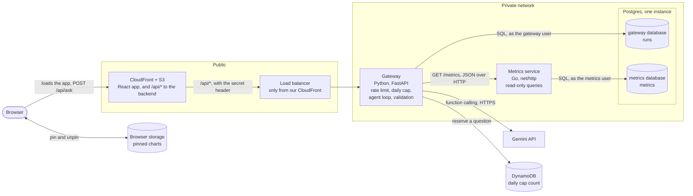
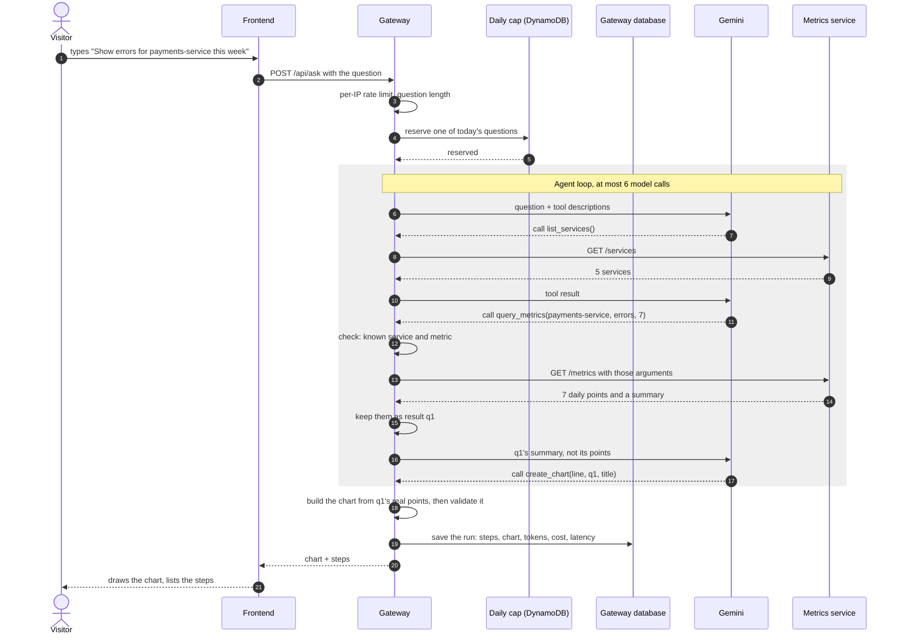
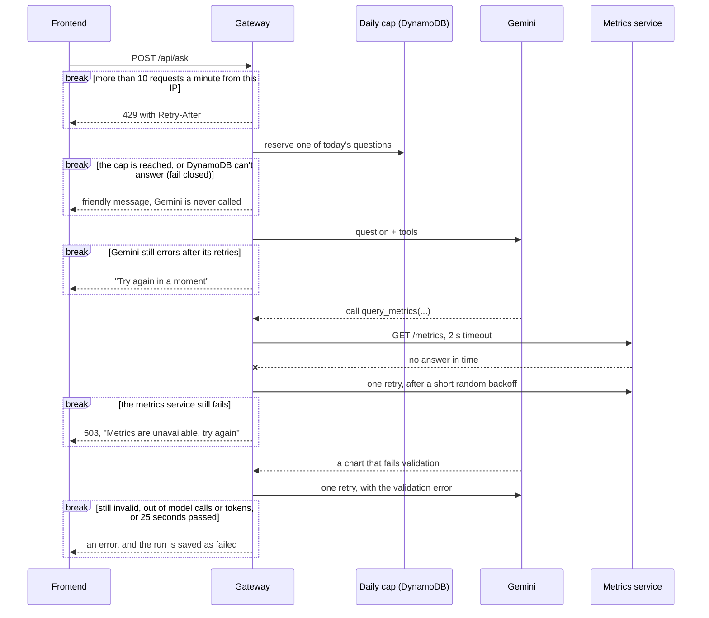
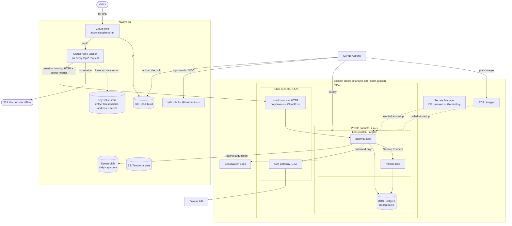
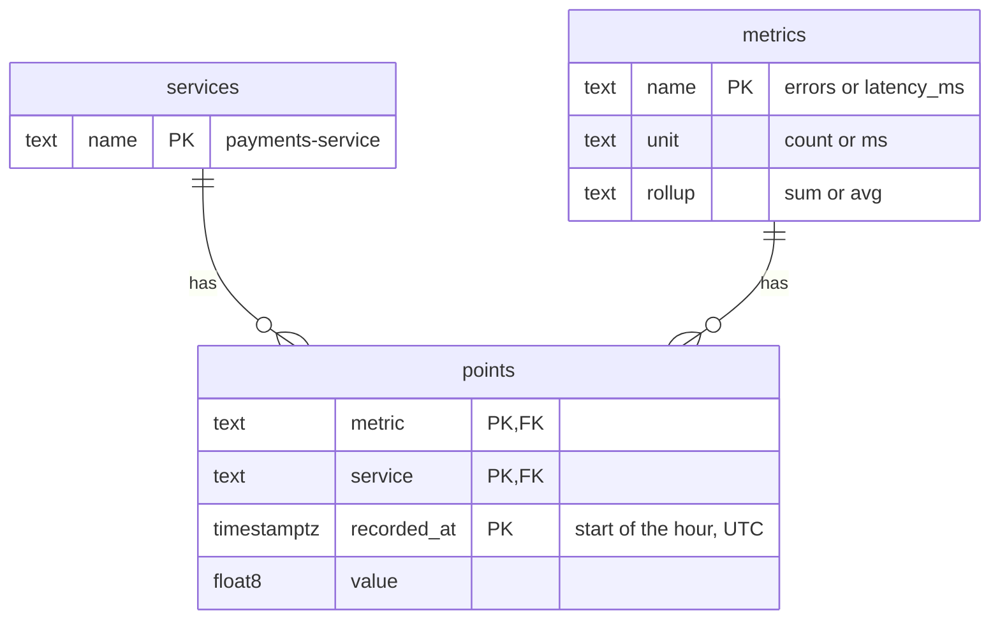
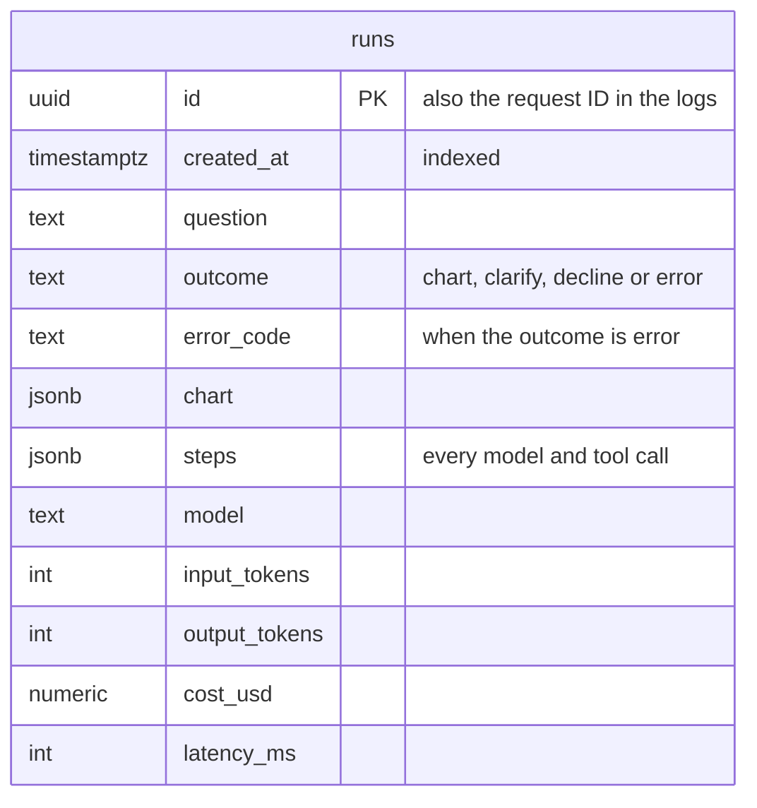

# System design

How DashGen should be built, and why. [architecture.md](architecture.md) describes what exists today; this doc works out the target, one step at a time: requirements, then estimates, then the design, deep dives and decisions. Sections are added as each step is worked through.

## 1. Requirements

### What it does

- Turns a plain-English question about the sample metrics into one chart (line, bar or pie), with the steps the agent took.
- Asks a clarifying question, with clickable choices, when the question is vague, and refuses off-topic questions with a few examples.
- Lets visitors pin charts to a dashboard saved in their browser. There are no accounts.
- Later, each as its own step: CSV upload, after the frontend works, and an MCP server.

### How well

| | Requirement |
|---|---|
| Users | Demo visitors: tens to a few hundred questions a day, with short spikes when the project is shared |
| Uptime | Up only while it's being worked on or demoed. A demo video covers the rest; there's no uptime promise |
| Budget | Under $25 a month for AWS and Gemini together |
| Speed | A chart within about 10 seconds |
| Data | Sample data only. Visitors can't change it |
| Security | Public and anonymous. The main risks are cost abuse and prompt injection. No personal data is stored |

### Out of scope for now

- Accounts and sign-in
- Real customer data
- High availability and multiple regions

## 2. Estimates

### Traffic

- 300 questions on a busy day average 0.0035 a second. A spike of 50 visitors asking 3 questions each within 10 minutes is 0.25 a second.
- Each question holds a request open for about 10 seconds, mostly waiting on Gemini, so even a spike means only 2–3 requests in flight at once.

### Gemini, per question

- 3–4 model calls: listing services, one or two queries, and creating the chart, which ends the run.
- About 8,000 input and 1,500 output tokens in total, because each call resends the conversation so far, including the tool descriptions and results. Thinking tokens are billed as output, so a model that thinks costs more.

| Model | Per 1M tokens, input / output | Per question | 300 questions |
|---|---|---|---|
| `gemini-3.1-flash-lite` | $0.25 / $1.50 | ~$0.004 | ~$1.30 |
| `gemini-3.8-flash`, until Dec 31, 2026 | $0.75 / $3.75 | ~$0.012 | ~$3.50 |
| `gemini-3.8-flash`, from Jan 1, 2027 | $1.50 / $7.50 | ~$0.023 | ~$7.00 |

Prices are from [Google's pricing page](https://ai.google.dev/gemini-api/docs/pricing), checked on 2026-10-26. Both models also have a rate-limited free tier, which is enough for development.

### Other providers, per question

| Model | Per 1M tokens, input / output | Per question | 300 questions |
|---|---|---|---|
| Claude Haiku 5.5, prompts up to 100K tokens | $0.10 / $0.50 | ~$0.0016 | ~$0.50 |
| OpenAI `gpt-6-luna` | $0.10 / $0.50 | ~$0.0016 | ~$0.50 |
| Claude Sonnet 5.5 | $2 / $10 | ~$0.031 | ~$9.30 |
| OpenAI `gpt-6-sol` | $2 / $10 | ~$0.031 | ~$9.30 |

Prices are from [Anthropic's](https://platform.claude.com/docs/en/about-claude/pricing) and [OpenAI's](https://developers.openai.com/api/docs/pricing) pricing pages, checked on 2026-10-26. At list prices, the smallest Claude and OpenAI models cost about a third of Gemini 3.1 Flash-Lite. Every small model fits the budget, though, so the choice comes down to how reliably each one calls tools, which step 6's evals measure, plus Gemini's free tier during development. The gateway keeps the model behind one small interface, so switching providers stays a contained change.

### AWS, while the stack is up

Approximate on-demand prices in us-east-1. Check them in the AWS pricing calculator before step 3.

| Part | Per hour |
|---|---|
| NAT gateway | $0.045 |
| Load balancer | $0.0225, plus a little per use |
| Postgres (db.t4g.micro) | $0.016 |
| Two Fargate tasks (0.25 vCPU, 0.5 GB each) | $0.025 |
| Three public IPv4 addresses | $0.015 |
| **Total** | **about $0.12** |

- A 4-hour session costs about $0.50, so ten sessions a month cost about $5.
- Left running all month, the same stack would cost about $90.
- Fixed costs: the [always-on part](#on-aws) costs a few cents a month at this traffic, and there's no domain ([ADR-0003](decisions/0003-cloudfront-front-door.md)).
- The AWS Free plan credits cover this at first.

### Data

- Metrics: 5 services × 2 metrics × 30 days × 24 hours = 7,200 rows, under 1 MB.
- Runs: a few KB each, so a few MB a year.

### What the estimates tell us

1. **Our servers will be nearly idle.** The bottleneck is Gemini: its latency, its price and its rate limits. So there's no cache, no queue and no autoscaling, just one small task per service. That also settles two earlier questions: a queue would have no load to smooth, and gRPC no latency worth saving. Both are worth building to learn, not because the design needs them.
2. **Gemini is the cost that can surprise us.** A busy day costs about $1.30 on Flash-Lite and $3.50–7 on Flash, so the model choice and the daily cap (step 4) are the main cost controls. Flash-Lite is the starting model, and step 6's evals can compare it with Claude Haiku and GPT Luna, which cost less per token.
3. **AWS costs time, not traffic.** About $0.12 an hour whether anyone visits or not, and the NAT gateway is over a third of it. Running only during sessions keeps AWS around $5 a month, and leaving it on would break the budget.
4. **The data is tiny.** The smallest Postgres instance is plenty, which gives step 2's database ADR its numbers.

## 3. High-level design

The diagrams are Mermaid: GitHub draws them, and VS Code does too with a Mermaid preview extension.

### Context: who uses DashGen, and what it depends on


### Containers: the parts and how they talk



| Part | Its job | Why it exists |
|---|---|---|
| CloudFront + S3 | The one address visitors use: serves the React app's files and forwards `/api/*` to the load balancer | Static files need no server, and one address means no CORS and no domain |
| Load balancer | Health checks, routing to the gateway | The backend's only door, open only to our CloudFront |
| Gateway | The agent loop, the rate limit, the daily cap, all validation | Keeps the Gemini key and every decision on the server |
| Metrics service | Answers metric queries | Owns the data, so nothing else touches its tables |
| Postgres | Two databases on one instance, each with its own user | The data is tiny, and separate databases keep ownership strict |
| DynamoDB | The daily cap's count | It has to outlive each session's database |
| Browser storage | Pinned charts | No accounts, so there's nothing to keep on the server |
| Gemini | Picks the tools and writes the chart spec | An outside service, behind one small interface in the gateway |

### One question, step by step



- **A day's cost has a ceiling.** The gateway reserves one of the day's questions before any work starts, and the loop stops at fixed limits on model calls and tokens ([the daily cap](#the-daily-cap)).
- **The model chooses, the code computes.** `create_chart` names a query result (`q1`), a chart type and a title, and never carries numbers. The gateway builds the chart from the metrics service's real response, so the model can't copy a value wrong or invent one.
- Tool arguments are checked against the known services and metrics before any tool runs. With read-only tools, that limits what an injected prompt can do: it can't write anything or reach other data, though it can still steer the agent to a misleading chart or spend part of the budget.

### When things go wrong

Each `break` box is a point where a request ends early. The arrow inside shows what the visitor gets.



- **Timeouts and retries:** every outside call has a timeout, and only errors worth retrying are retried, after a short random wait, so retries from many requests don't all land at once.
- **25 seconds per question,** under CloudFront's 30-second timeout, so a slow question gets the gateway's own error ([ADR-0003](decisions/0003-cloudfront-front-door.md) explains the three timeouts).
- The numbers here (6 calls, 25 seconds per question, a 2-second timeout, one retry) are starting values for step 6's evals to tune.

### On AWS



- **CloudFront is the only way in** ([ADR-0003](decisions/0003-cloudfront-front-door.md) has the details and the reasons). It serves the React app from S3 and runs a CloudFront Function on every `/api/*` request. During a session, the function forwards the request to the load balancer with a secret header, and the load balancer refuses anything without it. Between sessions, the function answers 503 "offline" itself, and the page shows its banner. The hop to the load balancer is plain HTTP, an accepted risk the ADR explains.
- **Public vs. private:** only CloudFront and the load balancer face the internet. The tasks and the database sit in private subnets, and the tasks reach outside services (Gemini, ECR, Secrets Manager, CloudWatch) through the NAT gateway. DynamoDB is the exception: a gateway endpoint, which is free, takes the cap's requests there without the NAT.
- **One NAT gateway, in one AZ,** because there's no uptime requirement, and it's already the biggest line on the hourly bill.
- **Two stacks:** the always-on one in the diagram costs a few cents a month, and the session stack holds everything else. `make down` drains the API before destroying it, and neither `make up` nor `make down` changes CloudFront's settings.
- **No keys anywhere:** secrets come from Secrets Manager when a task starts, and GitHub Actions signs in with OIDC.

## 4. Data and APIs

What each service stores, and the contracts between the parts. Roadmap step 2 builds the tables, and step 4 the tools, the daily cap and `/api/ask`.

### One Postgres, a database per service

- One Postgres instance holds two databases: `metrics`, which belongs to the metrics service, and `gateway`, which belongs to the gateway. Locally it's a Docker container; on AWS it's one RDS db.t4g.micro.
- Each service signs in as its own database user, which can't open the other database, and runs its own migrations. The gateway gets metrics only through the metrics service's API.
- The services stay as separate as if each had its own server, while we pay for one instance. Moving a database to its own instance later is a config change.

### The metrics database



- **`points` is the time series:** one row per metric, service and hour, so 7,200 rows for 30 days.
- **Its primary key is the index the queries need.** In `(metric, service, recorded_at)`, the columns that queries match exactly come first and the range comes last. "payments-service errors this week" reads one slice of the index, and "every service's latency this week" still uses its first column. An `id` column would only add a second index that nothing reads. At 7,200 rows Postgres reads the whole table in under a millisecond anyway; the key starts to matter at millions of rows.
- **`services` and `metrics` list what exists.** The metrics service checks names against them, the foreign keys stop a typo from inventing a service, and `list_services` reads them.
- **Each metric says how it rolls up.** Hourly errors add up to daily errors, while latency averages. The metrics service applies the rollup itself, so the model can't add up latencies.
- **The seed gives questions something to find:** daily and weekly cycles, some noise, and a few incidents, such as an error spike on `payments-service` two days ago. It uses a fixed random seed, so a given day always gets the same numbers and evals can know the right answers.
- **All times are UTC.** The frontend shows them in the visitor's time zone.

### The gateway database



- **One `runs` row per question that reached the agent,** whatever the outcome. Questions turned away before that (invalid, rate-limited or over the cap) cost nothing, so they aren't runs.
- **Steps are a `jsonb` column, not a table of their own:** they're always read with their run and never searched by themselves. Tokens, cost and latency are real columns, because step 7 adds them up per day.
- **No IP addresses.** The question is kept, for evals and debugging, and the page says so. On AWS, runs last only as long as the session's database.

### The daily cap

The cap keeps a runaway day from becoming a runaway bill. That takes two things: a ceiling on what one question can cost, and a count that outlives the session.

**What one question can cost.** The gateway enforces four limits:

- **6 model calls.** Every request to Gemini counts, including retries after an error, the reminder after a prose answer and the second try after a chart fails validation.
- **512 output tokens a call,** with thinking at its lowest level. The limit includes thinking tokens, which Gemini bills as output, so a question writes at most 3,072.
- **24,000 input tokens a question,** across all its calls, since each call resends the conversation so far. Gemini reports every call's tokens, and before the next call the gateway checks that it can't take the question past this budget. If it could, the run ends with `agent_failed`.
- **Short tool results.** The model sees a summary of each query, never its points, so a typical question needs about 8,000 input tokens, whatever the time range.

At Flash-Lite's prices that's at most $0.006 of input and $0.005 of output, about $0.011 a question. A different model means redoing this sum.

**The cap is 150 questions a day,** so Gemini costs at most about $1.60 a day. A month with ten session days comes to about $16, which leaves room for AWS's ~$5 within the $25 budget. A busier day gets the cap's message instead of charts.

**The count lives in the always-on stack.** `make down` destroys the session's database, so a count kept in Postgres would start over with every session, and two sessions on one day would get two days' worth. Instead, a DynamoDB table holds one item per UTC day, and one conditional write reserves a question:

```python
table.update_item(
    Key={"day": "2026-10-27"},  # today, in UTC
    UpdateExpression="ADD used :one SET expires_at = :expires",
    ConditionExpression="attribute_not_exists(used) OR used < :cap",
    ExpressionAttributeValues={":one": 1, ":cap": 150, ":expires": a_month_from_now},
)
```

The day's first question creates the item, and later ones add 1 only while it's under the cap. DynamoDB checks the condition and makes the change as one step, so two requests can't both take the last question, and every gateway container shares the count. A failed condition means the cap is reached. DynamoDB deletes old days by itself some time after `expires_at`.

- **Fail closed:** if DynamoDB doesn't answer, Gemini isn't called. A lost answer is cheaper than an unchecked bill.
- **A reservation is never given back,** even when the run fails, because a failed run may already have spent tokens.
- **The same code runs everywhere:** locally, DynamoDB Local runs in Docker Compose. On AWS the table costs a fraction of a cent a month.

**Gemini's own spend cap is the last line.** The Gemini project gets a $20 monthly spend cap in AI Studio. It also covers what the app's cap can't see, like evals or a bug in the cap itself. Google's billing data can lag about 10 minutes, so it isn't exact.

### The metrics service's API

The gateway is its only client. Compared with [today's API](architecture.md#metrics-api), it gains 30 days, hourly or daily buckets, units, a summary, and timestamps instead of dates.

| Endpoint | Answer |
|---|---|
| `GET /health` | `200 {"status": "ok"}`, without touching the database |
| `GET /services` | the services, plus each metric's unit and rollup |
| `GET /metrics?service=&metric=&days=&bucket=` | one series and its summary. `days` runs from 1 to 30, 7 by default. `bucket` is `hour` or `day`: hourly up to 2 days and daily beyond, unless the gateway asks for the other |

For `checkout-api` errors over 3 days, asked at 10:00 UTC:

```json
{
  "service": "checkout-api",
  "metric": "errors",
  "unit": "count",
  "bucket": "day",
  "points": [
    {"t": "2026-10-25T00:00:00Z", "value": 41},
    {"t": "2026-10-26T00:00:00Z", "value": 38},
    {"t": "2026-10-27T00:00:00Z", "value": 12, "partial": true}
  ],
  "summary": {"total": 91, "avg": 1.6, "min": 0, "max": 7, "latest": 1}
}
```

- **The summary comes from the hourly rows,** over the same window, whatever the bucket. So `max` is the worst hour, not the worst day, and `latest` is the last hour, not today so far. `avg` counts every hour the same. Only metrics that add up, like errors, get a `total`: a total of latencies means nothing.
- **Daily buckets are whole UTC days,** ending with today so far, so only the last one can be incomplete, and it's marked `partial`. Otherwise a day whose total is still growing would look like a drop.
- **Daily buckets keep long charts readable:** 30 days is 30 points instead of 720.
- **Health checks are shallow on purpose,** here and in the gateway: if the database blips, ECS and the load balancer shouldn't replace containers that are fine. Database trouble shows up as errors on real requests instead.

### The agent's tools

| Tool | Arguments | What the gateway does |
|---|---|---|
| `list_services` | none | returns the services and metrics, with units |
| `query_metrics` | `service`, `metric`, `days`, optional `bucket` | checks the names, calls `/metrics`, and keeps the result as `q1`, `q2` and so on. The model gets back the id, the unit, the number of points, the time range and the summary, never the points |
| `create_chart` | `type` (line, bar or pie), `sources` (result ids), `title`, and `aggregation` when comparing services | builds the chart from those results, which ends the run |
| `clarify` | `message`, and 2–4 `choices`, each a complete question | ends the run with the choices |
| `decline` | `reason` | ends the run with a short refusal and fixed example questions |

- **Every way to finish is a tool call** with a schema, so the gateway never parses free text. If the model answers in prose, it gets one reminder, and then the run fails.
- **A bad argument,** such as an unknown service, goes back to the model as a tool error and counts toward the 6 calls.
- **`aggregation`** (average, maximum, minimum, total or latest) turns each series into one number per service, for bar and pie charts that compare services. The number is that statistic from the query's [summary](#the-metrics-services-api). Pie charts show parts of a whole, so they only take totals. A chart can't mix metrics with different units.
- **The title says what's plotted, not a conclusion,** because the model writes it: "Average latency by service, last 7 days", not "checkout-api is the slowest".

### The public API

**`POST /api/ask`** takes `{"question": "..."}`, 1 to 300 characters after trimming. A `200` carries one outcome:

```json
{
  "run_id": "0f8b6c2e-5d4a-4c1e-9a3b-2d7e8f9a1b2c",
  "outcome": "chart",
  "chart": {
    "type": "line",
    "title": "payments-service errors per day, last 7 days",
    "unit": "count",
    "x": "time",
    "series": [
      {"name": "payments-service", "points": [{"x": "2026-10-21T00:00:00Z", "y": 41}]}
    ]
  },
  "steps": [
    {"tool": "query_metrics", "args": {"service": "payments-service", "metric": "errors", "days": 7}, "result": "q1: 7 daily points", "ms": 30}
  ]
}
```

- `outcome` is `chart`, `clarify` (with `message` and `choices`) or `decline` (with `message` and `examples`).
- `x` is `time` for a chart over time, or `category` when each point is a service.
- A point marked `"partial": true` is today's, in a daily chart. The frontend draws it lighter, since the day isn't over.
- A chart carries its own numbers, so charts pinned in the browser still draw while the backend is offline.

Errors share one shape, `{"error": {"code": "...", "message": "..."}}`, and the message is safe to show visitors:

| Status | Code | When |
|---|---|---|
| 422 | `invalid_question` | the question is missing, empty or over 300 characters |
| 429 | `rate_limited` | the 11th question in a minute from one IP, with `Retry-After` |
| 502 | `agent_failed` | no chart, clarifying question or refusal within the [question's limits](#the-daily-cap) |
| 503 | `daily_cap` | the day's questions are used up, with `Retry-After` until midnight UTC |
| 503 | `unavailable` | the database is down, or Gemini or the metrics service still fails after its retries |
| 504 | `timeout` | the question took over 25 seconds |

Between sessions, CloudFront's function answers `503 {"status": "offline"}` instead, and the request never reaches the gateway.

**Streaming (step 5):** with `Accept: text/event-stream`, the same answer arrives as Server-Sent Events: a `step` event as each tool call finishes, then one last event with the outcome or the error. Through CloudFront this needs `Accept` forwarded, which [ADR-0003](decisions/0003-cloudfront-front-door.md) sets up. Once the stream has started with a `200`, an error can only arrive as that last event. One agent loop produces the events, and JSON and the stream are two ways of sending them, so evals and `curl` use JSON while the page uses the stream.

**`GET /api/health`** answers `200 {"status": "ok"}` with `Cache-Control: no-store`.

### Why Postgres

- The agent's questions aren't known in advance, and SQL answers new ones with filters, ranges and `GROUP BY`, without redesigning the tables. DynamoDB needs every query designed up front and can't group. MongoDB suits documents whose shape varies, and this data's shape is fixed.
- One engine covers the time series and the runs, and it runs the same in Docker, in CI and on RDS.
- **The daily cap is the exception.** Its count has to outlive the session's database, and a single item read and written by its key is what DynamoDB does best.
- At millions of points a day, the time series would move to TimescaleDB or ClickHouse, and each database would get its own instance. Step 2's ADR records this.

Next: step 5, deep dives into the gateway's parts and the agent loop, then step 6, decisions and how the design grows.
