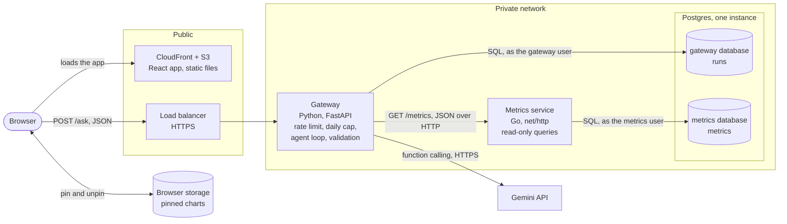
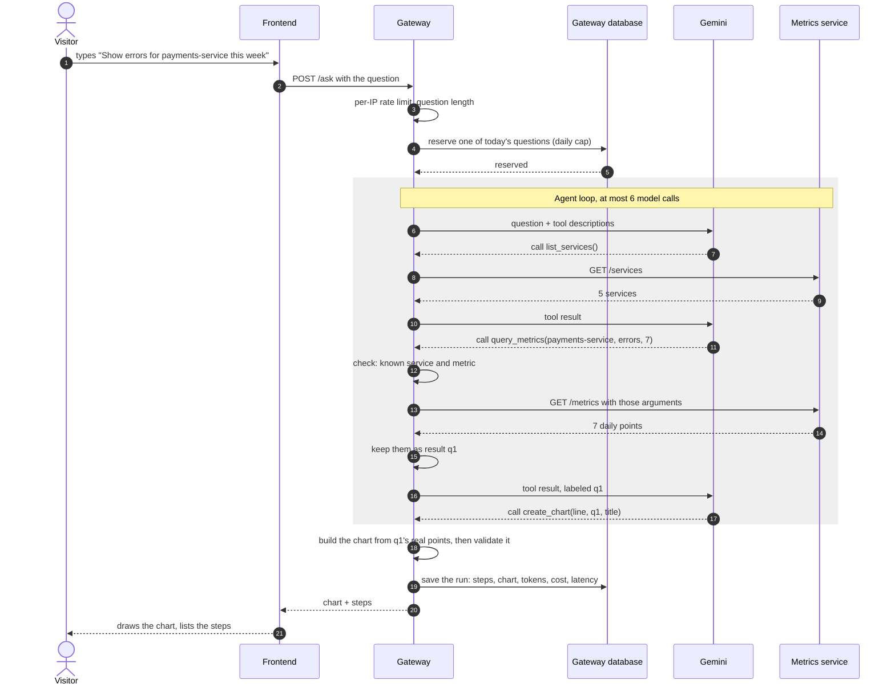
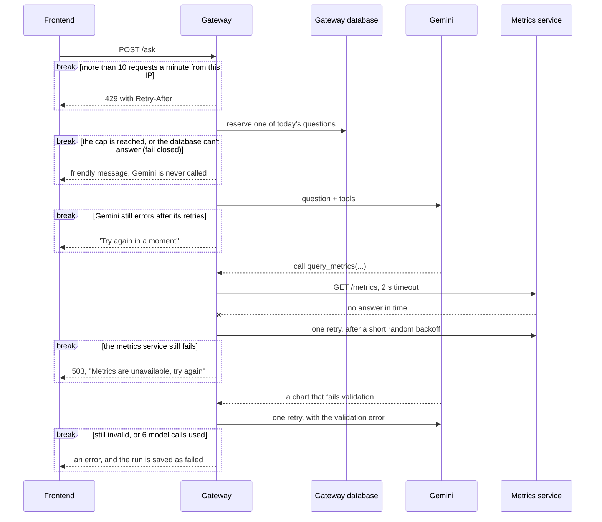
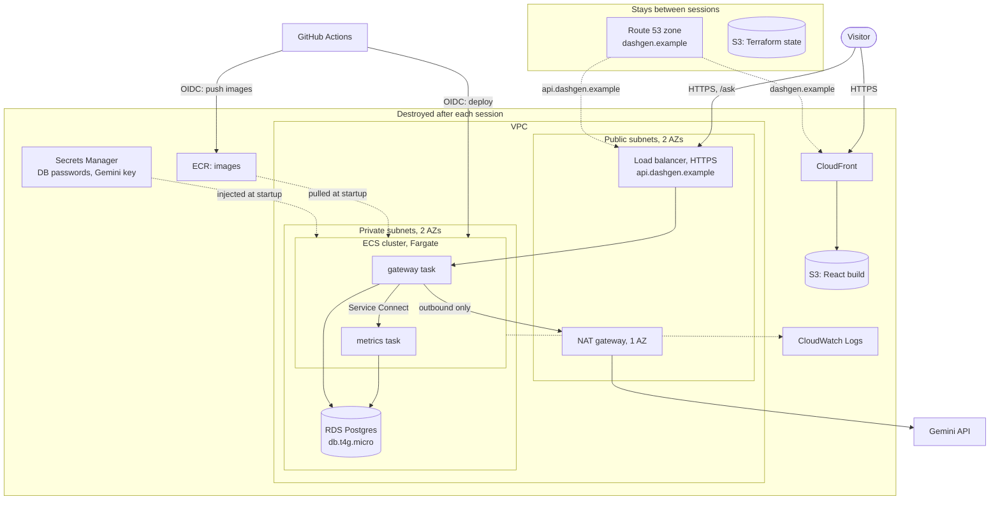

# System design

How DashGen should be built, and why. [architecture.md](architecture.md) describes what exists today; this doc works out the target, one step at a time: requirements, then estimates, then the design, deep dives and decisions. Sections are added as each step is worked through.

## 1. Requirements

### What it does

- Turns a plain-English question about the sample metrics into one chart (line, bar or pie), with the steps the agent took.
- Asks a clarifying question, with clickable choices, when the question is vague, and refuses off-topic questions with a few examples.
- Lets visitors pin charts to a dashboard saved in their browser. There are no accounts.
- Later, each as its own step: CSV upload, after the frontend works, and an MCP server.

### How well

| | Requirement |
|---|---|
| Users | Demo visitors: tens to a few hundred questions a day, with short spikes when the project is shared |
| Uptime | Up only while it's being worked on or demoed. A demo video covers the rest; there's no uptime promise |
| Budget | Under $25 a month for AWS and Gemini together |
| Speed | A chart within about 10 seconds |
| Data | Sample data only. Visitors can't change it |
| Security | Public and anonymous. The main risks are cost abuse and prompt injection. No personal data is stored |

### Out of scope for now

- Accounts and sign-in
- Real customer data
- High availability and multiple regions

## 2. Estimates

### Traffic

- 300 questions on a busy day average 0.0035 a second. A spike of 50 visitors asking 3 questions each within 10 minutes is 0.25 a second.
- Each question holds a request open for about 10 seconds, mostly waiting on Gemini, so even a spike means only 2–3 requests in flight at once.

### Gemini, per question

- 3–4 model calls: listing services, querying metrics, creating the chart, and the final answer.
- About 8,000 input and 1,500 output tokens in total, because each call resends the conversation so far, including the tool descriptions and results. Thinking tokens are billed as output, so a model that thinks costs more.

| Model | Per 1M tokens, input / output | Per question | 300 questions |
|---|---|---|---|
| `gemini-3.1-flash-lite` | $0.25 / $1.50 | ~$0.004 | ~$1.30 |
| `gemini-3.8-flash`, until Dec 31, 2026 | $0.75 / $3.75 | ~$0.012 | ~$3.50 |
| `gemini-3.8-flash`, from Jan 1, 2027 | $1.50 / $7.50 | ~$0.023 | ~$7.00 |

Prices are from [Google's pricing page](https://ai.google.dev/gemini-api/docs/pricing), checked on 2026-10-26. Both models also have a rate-limited free tier, which is enough for development.

### Other providers, per question

| Model | Per 1M tokens, input / output | Per question | 300 questions |
|---|---|---|---|
| Claude Haiku 5.5, prompts up to 100K tokens | $0.10 / $0.50 | ~$0.0016 | ~$0.50 |
| OpenAI `gpt-6-luna` | $0.10 / $0.50 | ~$0.0016 | ~$0.50 |
| Claude Sonnet 5.5 | $2 / $10 | ~$0.031 | ~$9.30 |
| OpenAI `gpt-6-sol` | $2 / $10 | ~$0.031 | ~$9.30 |

Prices are from [Anthropic's](https://platform.claude.com/docs/en/about-claude/pricing) and [OpenAI's](https://developers.openai.com/api/docs/pricing) pricing pages, checked on 2026-10-26. At list prices, the smallest Claude and OpenAI models cost about a third of Gemini 3.1 Flash-Lite. Every small model fits the budget, though, so the choice comes down to how reliably each one calls tools, which step 6's evals measure, plus Gemini's free tier during development. The gateway keeps the model behind one small interface, so switching providers stays a contained change.

### AWS, while the stack is up

Approximate on-demand prices in us-east-1. Check them in the AWS pricing calculator before step 3.

| Part | Per hour |
|---|---|
| NAT gateway | $0.045 |
| Load balancer | $0.0225, plus a little per use |
| Postgres (db.t4g.micro) | $0.016 |
| Two Fargate tasks (0.25 vCPU, 0.5 GB each) | $0.025 |
| Three public IPv4 addresses | $0.015 |
| **Total** | **about $0.12** |

- A 4-hour session costs about $0.50, so ten sessions a month cost about $5.
- Left running all month, the same stack would cost about $90.
- Fixed costs: the domain, about $1 a month averaged over a year, and its DNS zone, $0.50 a month.
- The AWS Free plan credits cover this at first.

### Data

- Metrics: 5 services × 2 metrics × 30 days × 24 hours = 7,200 rows, under 1 MB.
- Runs: a few KB each, so a few MB a year.

### What the estimates tell us

1. **Our servers will be nearly idle.** The bottleneck is Gemini: its latency, its price and its rate limits. So there's no cache, no queue and no autoscaling, just one small task per service. That also settles two earlier questions: a queue would have no load to smooth, and gRPC no latency worth saving. Both are worth building to learn, not because the design needs them.
2. **Gemini is the cost that can surprise us.** A busy day costs about $1.30 on Flash-Lite and $3.50–7 on Flash, so the model choice and the daily cap (step 4) are the main cost controls. Flash-Lite is the starting model, and step 6's evals can compare it with Claude Haiku and GPT Luna, which cost less per token. Tool results are the biggest part of the input, so sending daily totals instead of hourly points for long ranges cuts the cost further.
3. **AWS costs time, not traffic.** About $0.12 an hour whether anyone visits or not, and the NAT gateway is over a third of it. Running only during sessions keeps AWS around $5 a month, and leaving it on would break the budget.
4. **The data is tiny.** The smallest Postgres instance is plenty, which gives step 2's database ADR its numbers.

## 3. High-level design

The diagrams are Mermaid: GitHub draws them, and VS Code does too with a Mermaid preview extension.

### Context: who uses DashGen, and what it depends on

### Containers: the parts and how they talk

| Part | Its job | Why it exists |
|---|---|---|
| CloudFront + S3 | Serves the React app's files | Static files need no server, so this is cheap and fast |
| Load balancer | HTTPS, health checks, routing to the gateway | The only public door to the backend |
| Gateway | The agent loop, the rate limit, the daily cap, all validation | Keeps the Gemini key and every decision on the server |
| Metrics service | Answers metric queries | Owns the data, so nothing else touches its tables |
| Postgres | Two databases on one instance, each with its own user | The data is tiny, and separate databases keep ownership strict |
| Browser storage | Pinned charts | No accounts, so there's nothing to keep on the server |
| Gemini | Picks the tools and writes the chart spec | An outside service, behind one small interface in the gateway |

### One question, step by step

- **The daily cap is reserved before any work starts.** One SQL statement adds 1 to today's counter only while it's under the cap (`UPDATE … SET used = used + 1 WHERE used < cap RETURNING used`), so parallel requests can't all slip past a separate check. The cap counts questions: each one makes at most 6 model calls, so its worst-case cost is known, and the cap times that worst case is the most a day can cost.
- **The model chooses, the code computes.** `create_chart` names a query result (`q1`), a chart type and a title, and never carries numbers. The gateway builds the chart from the metrics service's real response, so the model can't copy a value wrong or invent one. For comparisons, the model names an aggregation, like average, maximum or latest, and the gateway does the math.
- The loop has a hard limit of 6 model calls, so a confused model can't run up the bill.
- Tool arguments are checked against the known services and metrics before any tool runs. With read-only tools, that limits what an injected prompt can do: it can't write anything or reach other data, though it can still steer the agent to a misleading chart or spend part of the budget.
- Every run is saved, whether it succeeds or fails, for cost tracking.

### When things go wrong

Each `break` box is a point where a request ends early. The arrow inside shows what the visitor gets.

- **Fail closed:** if the cap can't be checked, Gemini isn't called. A lost answer is cheaper than an unchecked bill.
- **Timeouts and retries:** every outside call has a timeout, and only errors worth retrying are retried, after a short random wait, so retries from many requests don't all land at once.
- The numbers here (6 calls, a 2-second timeout, one retry) are starting values for step 6's evals to tune.

### On AWS

- **Public vs. private:** only the load balancer and CloudFront face the internet. The tasks and the database sit in private subnets, and the tasks reach outside services (Gemini, ECR, Secrets Manager, CloudWatch) through the NAT gateway.
- **One NAT gateway, in one AZ,** because there's no uptime requirement, and it's already the biggest line on the hourly bill.
- **Two stacks:** the small one keeps the Terraform state and the domain's DNS, and the rest is destroyed after each session.
- **No keys anywhere:** secrets come from Secrets Manager when a task starts, and GitHub Actions signs in with OIDC.
- `dashgen.example` stands in for the real domain until it's bought.

Next: step 4, data and APIs, with a diagram of the tables, then step 5's deep dives into the gateway's parts and the agent loop.
